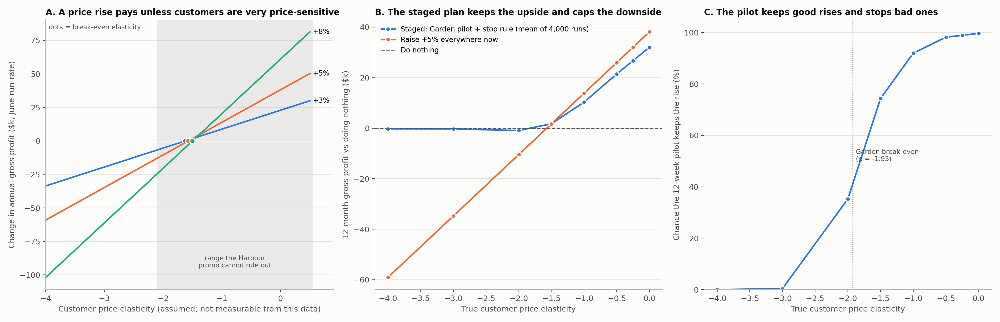
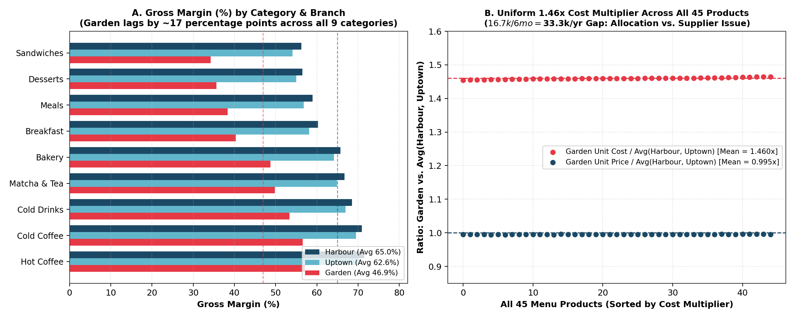
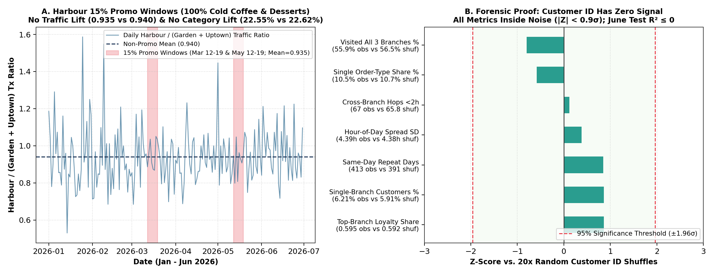
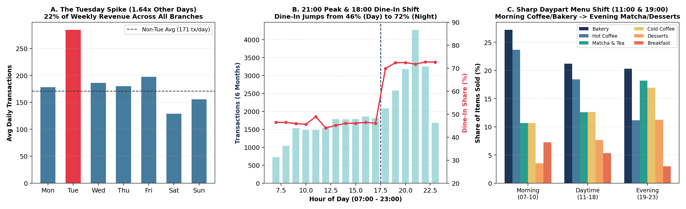
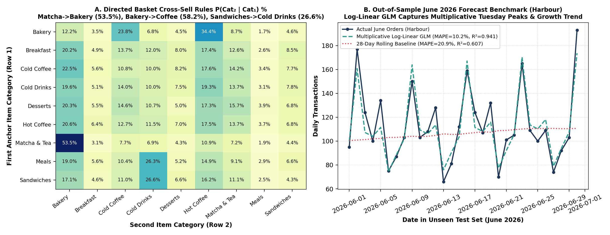
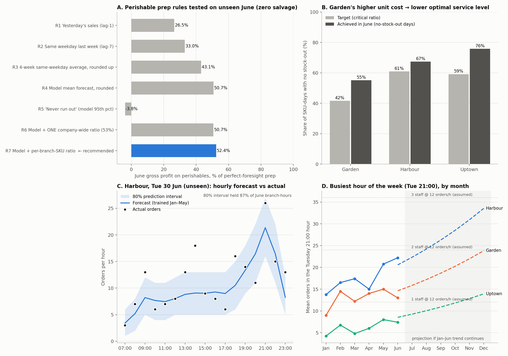

# Stories Coffee: What the Sales Data Says to Do Next

**EECE490 Hackathon. Team: Alex Chbib, Ricardo Ghossoub**

**Data:** `stories_transactions.csv`, with 51,177 line items in 33,887 orders across 3 branches (Harbour, Garden, Uptown) from 1 January to 30 June 2026.

**How to check our work:** every number in this README comes from the scripts in `src/`. [`src/11_readme_fact_check.py`](src/11_readme_fact_check.py) recomputes the headline figures directly from the raw CSV ([output](outputs/11_readme_fact_check.txt)). See [Reproduce](#11-reproduce-our-results).

**Labels used throughout:** **Measured** = computed directly from the data. **Estimated** = depends on an assumption, which we state next to it.

---

## Conclusion for the CEO

Stories earned **\$305,925 in revenue and \$179,430 in gross profit (58.7%)** in the first half of 2026, and daily orders grew **57%** from January to June.

- **Price is the largest profit lever we found.** A 5% menu price rise is worth about **\$26k a year** in gross profit if customers are moderately price-sensitive, and up to \$38k if they are not. It loses money only if customers are very price-sensitive. Stories' data cannot tell which is true, so we recommend a **safe test**: raise Garden's prices 5%, which puts Garden exactly on the price list Harbour already charges. Roll back automatically if sales fall past the break-even point, and extend to other branches one at a time. Simulated on Stories' own day-to-day sales, this earns **about \$21k in the first 12 months** in the moderate case, and **averages no worse than a \$942 loss** in the worst case.
- **Next, find out why Garden's unit costs are 1.46x the other branches' on every single item** (\$16.7k of extra cost in six months). It may be an accounting choice rather than money that can be saved.
- **Finally, stop untargeted discounts, and use our tested forecasts to set daily food prep and hourly staffing.**
- **Do not build loyalty or churn models on the current Customer IDs.** They behave like random codes.

---

## Recommended actions at a glance

| # | Action | Measured evidence | Estimated value | How sure we are | What would change our mind | First step |
| :-: | :--- | :--- | :--- | :--- | :--- | :--- |
| 1 | **Staged 5% price rise, Garden first** ([§2](#2-headline-the-pricing-decision)) | The only past price change (Harbour's 15% promo) did not change traffic (+0.7%; 95% range −5% to +7%). Its effect on the discounted items is unclear (−8% to +32%). | About \$21k in 12 months if customers are moderately price-sensitive. Up to \$38k/yr if they are not. | Medium. The value depends on price sensitivity, which the data cannot measure. | Garden's sales falling more than 9.6% (its break-even) during the pilot | 12-week Garden pilot with a weekly check and a stop rule |
| 2 | **Audit Garden's unit costs** ([§3](#3-garden-pays-146x-more-per-item)) | Garden's cost is 1.46x the other branches' on all 45 items: \$16,667 extra in 6 months | \$0 to \$33k/yr | High that the gap exists. Low that it can be saved. | The gap being an accounting allocation: then the cash saving is \$0 | Compare supplier invoices for 5 items across the 3 branches |
| 3 | **Stop untargeted discounts** ([§4](#4-discounts-cost-money-without-bringing-in-customers)) | \$2,179 of discounts in 6 months. The 10% discount is spread at random. The 15% promo brought no extra traffic. | Up to about \$4.4k/yr | Medium | The 10% being staff meals or complaint compensation | Limit the 10% button to managers on alternate days for 2 weeks |
| 4 | **Set daily food prep from a forecast** ([§8](#8-models-tested-on-unseen-june-data)) | In a June test, our rule earned 52% of the best possible profit on perishable items, vs 43% for a typical "4-week average" rule | About \$52/day in simulation (an upper estimate) | Medium for the method, low for the dollar figure | Customers switching to another item when one sells out | 4-week trial at one branch with daily waste logs |
| 5 | **Staff each hour from a forecast** ([§8](#8-models-tested-on-unseen-june-data)) | June understaffed hours: 9 with our forecast vs 28 with a plain hourly average | Depends on wage and staff speed, neither of which is in the data | Low for the dollar figure | Measured orders per staff member per hour | Time Tuesday evening orders for 2 weeks |
| 6 | **Suggest one add-on at the till, with no discount** ([§6](#6-what-customers-buy-together)) | 46% of orders already have 2+ items. 53.5% of second items after a Matcha/Tea drink are bakery. | \$1.4k–\$6.8k/yr if 1–5% of single-item orders add an item | Low: the conversion rate is unknown | Prompts slowing the evening queue | 3-week trial on alternating shifts |
| 7 | **Do not build customer-level models yet** ([§7](#7-customer-ids-cannot-be-used-yet)) | Customer IDs behave like random codes. Models of June behavior did no better than simple averages. | Avoids wasted spend | High | Real loyalty sign-ups (phone or app) | Ask the POS team how IDs are entered |

---

## 1. Data checks

Measured with [`src/01_forensic_audit_and_eda.py`](src/01_forensic_audit_and_eda.py) and [`src/11_readme_fact_check.py`](src/11_readme_fact_check.py).

- **Complete and consistent.** The data covers 181 consecutive days with none missing. Each order has one date, time, branch, order type and customer. Every line satisfies `revenue = quantity × price × (1 − discount)` (largest rounding error: \$0.005) and `gross profit = revenue − quantity × unit cost`. No line has zero or negative profit.
- **Prices and costs never change.** Every item at every branch keeps the same price and cost for all six months.
- **Missing Customer IDs.** 36.45% of orders have no Customer ID. The gaps are spread evenly across branches, hours, categories and basket sizes (every test p ≥ 0.35), so they don't bias the other results.
- **132 exact duplicate rows** (\$741 of revenue), the same item appearing twice in one order. These could be double scans or genuine repeat items. Removing them changes revenue by 0.24% and changes none of our conclusions, so we kept them.
- **Timestamps.** Transaction IDs run in date order but not in time order within a day, and the minutes and seconds within each hour are evenly spread. We therefore did not analyze time between orders or queue waits.

---

## 2. Headline: the pricing decision

Script: [`src/10_pricing_decision.py`](src/10_pricing_decision.py). Output: [`outputs/10_pricing_decision_report.txt`](outputs/10_pricing_decision_report.txt).



**Key term.** *Price sensitivity* is the % change in units sold for a 1% price rise. At −0.5, a 5% price rise loses 2.5% of units. At −2, it loses 10%.

**Measured: what the only past price change tells us.** Harbour cut Cold Coffee and Desserts by 15% for 16 days (12–19 March and 12–19 May). We compared Harbour with Garden and Uptown on the same days, using two different sets of comparison days:

| During the promo | Compared with other March and May days | Compared with all other days (adjusted for month and weekday) |
| :--- | :---: | :---: |
| Harbour's number of orders | **+0.7%** (95% range −5.1% to +6.8%) | +0.3% (−4.5% to +4.8%) |
| Units of the discounted items | **+9.6%** (95% range −8.3% to +31.6%) | +6.1% (−4.9% to +18.7%) |

Orders did not increase. The item-level result is consistent with price sensitivity anywhere from **−2.1 to +0.5**, so **the data cannot tell whether customers ignore price or are very sensitive to it**. The reason is the test's size: 16 days at one branch, about 20 discounted units a day, and day-to-day swings of about 14%.

**Estimated: what a price rise is worth** (at June's sales pace of about \$762k revenue a year, assuming no further growth):

| Price rise | Sales drop that cancels the gain | Break-even price sensitivity | Gross profit/yr at sensitivity 0 | at −0.5 | at −1.0 | at −2.0 |
| :---: | :---: | :---: | :---: | :---: | :---: | :---: |
| +3% | 4.9% | −1.62 | \$22,864 | \$15,805 | \$8,745 | −\$5,375 |
| **+5%** | **7.9%** | **−1.57** | **\$38,107** | **\$25,960** | **\$13,813** | **−\$10,482** |
| +8% | 12.0% | −1.50 | \$60,972 | \$40,621 | \$20,271 | −\$20,429 |

**Recommended plan: a staged 5% rise with a stop rule.**
1. **Start at Garden.** +5% puts Garden exactly on Harbour's existing price list. Garden's lower margin also makes it the branch that can absorb the largest sales drop before a rise loses money. Its break-even sales drop is 9.6%, against 7.1% at Harbour and 7.4% at Uptown.
2. **Check every week.** Compare Garden's units sold with Harbour and Uptown, relative to the 8 weeks before. Roll back as soon as we are 80% confident the drop is larger than 9.6%.
3. **After 12 weeks, extend one branch at a time.** Each branch gets the rise only if the measured drop is within *that branch's* break-even. Our first version of the simulation extended to all branches based on Garden's result alone. That spread losing price rises when customers were sensitive, so we fixed it.

**Estimated: the plan simulated 4,000 times per scenario**, replaying Stories' real day-to-day sales swings from January–June:

| True price sensitivity | Raise 5% everywhere now (12-month gross profit) | Staged plan: average | Staged plan: worst 5% of runs | Chance Garden keeps the rise | Chance it reaches Harbour |
| :---: | :---: | :---: | :---: | :---: | :---: |
| 0.0 | \$38,107 | \$32,030 | \$32,156 | 100% | 100% |
| −0.5 | \$25,960 | \$21,440 | \$22,073 | 98% | 96% |
| −1.0 | \$13,813 | \$10,292 | \$226 | 92% | 79% |
| −1.5 | \$1,665 | \$1,736 | \$52 | 74% | 42% |
| −2.0 | −\$10,482 | −\$942 | −\$8,178 | 35% | 9% |
| −3.0 | −\$34,777 | −\$301 | −\$917 | 0% | 0% |

The caution costs about \$6k if customers ignore price. In return, it avoids losses of \$10k–\$35k a year if they don't.

**Assumptions that could change the plan:**
- **Discount vs rise.** A temporary 15% discount on two categories may not predict how customers react to a permanent rise on the whole menu.
- **Even, immediate reaction.** We assume customers react the same way to every item, and right away. To catch a slow drift, keep the weekly comparison running for 6 months after rollout.
- **No branch switching.** If Garden customers move to Harbour, the pilot reads that as price sensitivity and errs on the cautious side.
- **Nothing else changes.** No other promotion, menu change or local event at Garden during the pilot.
- **No growth.** Dollar values use June's pace. Continued growth would raise them.
- **Weak supporting evidence.** Harbour already charges 5.0% more than Garden and 9.4% more than Uptown on every item, and its customers buy the same baskets (about 1.51 items per order at all three branches). That shows customers accept Harbour's prices, but it does not measure price sensitivity, because each branch has different customers.

---

## 3. Garden pays 1.46x more per item



**Measured:**
- Gross margin is **65.0% at Harbour, 62.6% at Uptown and 46.9% at Garden**.
- Prices differ only slightly. Harbour is 5% above Garden on every item, and Uptown is 4% below.
- **Garden's unit cost is 1.46x the average of the other two branches on all 45 items** (range 1.455–1.465). That includes bottled water: Still Water costs \$0.93 at Garden vs \$0.65 at Harbour and \$0.62 at Uptown.
- At Garden's sales volume (17,833 units), the gap is **\$16,667 of extra cost in 6 months**, or about \$33k a year.
- Pricing cannot close the gap. Even at Harbour's prices, Garden's margin would only rise from 46.9% to 49.4%.

**Challenging our first explanation.** Our first thought was waste or theft at Garden. But waste would hit fresh food much harder than bottled water, and here the same 1.46x applies to every item. **A uniform gap looks more like how costs are recorded** (for example, rent or labor built into Garden's unit costs) **or a different supplier price list.** The data cannot separate these.

**Action:** compare Garden's supplier invoices with the other branches' for 5 items (Still Water, Espresso, Butter Croissant, Iced Matcha, Turkey & Cheese Sandwich).
- If the invoices match, the gap is an accounting allocation. Fix the reporting; there is no cash to save.
- If the invoices differ, move Garden onto the other branches' supplier terms, worth up to \$33k a year.

---

## 4. Discounts cost money without bringing in customers



**Measured:** Stories gave **\$2,179 of discounts in 6 months** (about \$4.4k a year), in two forms.
1. **The Harbour 15% promo** (\$472, 504 lines). It ran only at Harbour, only on Cold Coffee and Desserts, and only on 12–19 March and 12–19 May. Every Cold Coffee and Dessert line at Harbour on those days got it. Harbour's orders did not rise (+0.7%; 95% range −5% to +7%). Breaking even would have needed 29% more units of those items, and the measured change is unclear (+9.6%; range −8% to +32%).
2. **A 10% discount on 5.6% of lines** (\$1,707), spread evenly across every branch, month, hour and category. Customers with and without a Customer ID get it equally often (5.58% vs 5.61%). Customers can't know about this discount before ordering, so it can't bring in sales.

**Action:**
- Don't repeat the 15% promo in this form.
- Find out what the 10% discount is (staff meals? compensation for a mistake?). If it has no purpose, restrict it to managers.
- **Test first:** restrict it on alternate days for 2 weeks and compare daily sales and gross profit.

---

## 5. When customers come



**Measured:**
- **Tuesday is 1.66x busier** than the average other day (284.5 vs 170.9 orders/day). The ratio was between 1.44x and 1.81x in every one of the 25 complete weeks. Saturday is the quietest day (128.7). On Tuesdays, customers buy the same things in the same proportions; there are just more of them.
- **Steady growth.** Orders per day rose every month: 146.6 (Jan), 165.0, 181.5, 191.7, 207.7, 230.2 (Jun), which is +57%.
- **Stories is an evening business.** Half of all orders and half of gross profit come from 18:00 onward. The busiest hour is 21:00 (4,273 orders), and 20:00–22:59 accounts for 31.6% of orders. The quietest hour is 07:00 (724 orders).
- **At 18:00, dine-in takes over.** Takeaway is 54.0% of orders before 18:00 and 28.0% after.
- **Checking for a misleading pattern.** Across the whole day, some categories look "more takeaway" than others. Within the same time of day, the difference disappears (p = 0.63 morning, 0.27 midday, 0.45 evening). Time of day drives both what people order and whether they stay.

**Action:** plan staff and prep around Tuesdays and evenings (see [§8](#8-models-tested-on-unseen-june-data)).

---

## 6. What customers buy together

**Measured:**
- **46.4% of orders have 2 or 3 items.** The other 18,175 orders have just one.
- **Strong pairings.** We compared real baskets with baskets shuffled within the same branch and hour, which removes the time-of-day effect:
  - Bakery + Matcha/Tea appears 1.63x more often than chance (2,076 vs 1,272 expected).
  - Cold Drinks + Sandwiches appears 1.88x more often (549 vs 291).
- **When the first item is a Matcha/Tea drink, 53.5% of second items are bakery.** When it's a sandwich, 26.6% are cold drinks.
- **Customers often pick the cheapest option in a category.** Unit gross profit at Harbour / Garden:

| Usual choice | Gross profit per unit | Suggested alternative | Gross profit per unit |
| :--- | :---: | :--- | :---: |
| Still Water | \$1.40 / \$1.02 | Lemonade | \$3.71 / \$2.98 |
| Sparkling Water | \$1.54 / \$0.82 | Fresh Orange Juice | \$3.92 / \$2.72 |
| Chocolate Cookie | \$2.40 / \$1.85 | Almond Croissant | \$3.18 / \$2.12 |
| Butter Croissant | \$2.69 / \$2.02 | Banana Bread | \$3.10 / \$2.20 |

**Action:** a till prompt with **no discount**, naming one specific item: "Add a Lemonade?" with a sandwich, or "Add an Almond Croissant?" with a matcha.
- **Estimated value** (assumption: each converted add-on earns \$3.04 of gross profit, the June test figure from [§8](#8-models-tested-on-unseen-june-data)). At June's pace of about 44,968 single-item orders a year: **\$1,367/yr at 1% conversion, \$4,101 at 3% and \$6,835 at 5%**.
- **Why not a "10% off your second item" bundle?** It would also discount the orders that already include a second item: about **\$25k a year** at June's pace. It only breaks even if **19% of single-item customers** start adding an item.
- **Risk:** spoken prompts slow the queue at the 21:00 peak, so use a screen prompt at busy times.

---

## 7. Customer IDs cannot be used yet

**Measured:** the 21,534 orders with a Customer ID look like random draws from a fixed set of 3,500 codes:
- **Visits per ID are spread exactly as pure chance would produce** (variance/mean = 0.99; 1.00 is pure chance).
- **Fast branch-hopping matches chance.** 67 times, the same ID appears at two branches within 2 hours. Randomly shuffled IDs produce 65.8 ± 10.1.
- **"New customers" collapse only because the pool of codes runs out.** New IDs fall from 1,979 in January to 20 in June, as expected once almost all 3,500 codes have been seen.
- **ID'd and anonymous orders are the same.** Average spend is \$9.02 vs \$9.04.
- **Models built on customer history fail on unseen June data.**
  - June visits: R² of −0.0012 for the average, and Ridge and Random Forest models don't beat it.
  - Customers' "favorite branch" from January–May predicts their June branch **worse** than simply guessing Harbour (41.2% vs 49.3% correct).

**Possible explanation (not confirmed):** cashiers may be entering default or rotating codes. **Action:**
- Don't fund churn, loyalty or personalization models on this data.
- Fix ID capture first, for example with phone number or app login.

---

## 8. Models tested on unseen June data

Every model was trained on January–May and tested on June, which it never saw, and compared with simple rules a manager could use. Scripts: [`08`](src/08_run_models_and_plots.py), [`09`](src/09_prep_and_staffing_optimizer.py).



**A. Daily orders per branch** (for planning the week):

| Method | June error (MAPE) | R² |
| :--- | :---: | :---: |
| January–May average | 23.4% | 0.36 |
| Same day last week | 13.9% | 0.90 |
| Linear trend + weekday + branch | 14.9% | 0.84 |
| Gradient boosting (complex) | 12.3% | 0.89 |
| **Growth-rate model: trend + weekday + branch, in percentage terms** | **10.6%** | **0.94** |

The simple percentage model wins because Stories' patterns multiply. Tuesday is about 1.66x any day, and that gap grows as the business grows. The complex model can't project growth beyond what it has already seen.

**B. How much perishable food to prep each day** (22 bakery, breakfast, dessert, meal and sandwich items, 45% of units sold).
- **Our rule:** forecast tomorrow's demand for each item, then prep more for high-margin items and less for low-margin ones. This balances the profit lost when an item sells out against the cost of throwing an item away.
- **The link to Garden:** because Garden's costs are higher, it should aim to avoid sell-outs on only **42%** of days, vs **61%** at Harbour. In plain terms, **Garden should prep less**.

| Prep rule (tested on June, unsold food thrown away) | Share of the best possible profit |
| :--- | :---: |
| Yesterday's sales | 26.5% |
| Same day last week | 33.0% |
| 4-week average for that weekday, rounded up | 43.1% |
| Our forecast, prepping the average | 50.7% |
| **Our forecast, with margin-based prep levels** | **52.4%** |
| "Never run out" (prep for 95% of days) | −3.8% (loses money) |

- **Measured in simulation:** \$51.7 more gross profit per day than the 4-week-average rule (95% range \$42.7–\$60.4). Garden gains the most: \$1,648 vs \$913 in June.
- **About 80% of the gain comes from the better forecast**, and about 20% from setting prep levels by margin.
- **Assumptions:** recorded sales equal true demand, customers don't switch to a similar item when one sells out, and there are no batch sizes. These make the dollar gain an upper estimate; the ranking of the rules is more reliable.

**C. Orders per hour** (for staffing):
- **Accuracy.** Average June error is **1.62 orders/hour**, vs 1.78 for the January–May average and 2.24 for "same hour last week". The model's 80% prediction ranges contained 87% of actual June hours.
- **Staffing.** At an assumed 12 orders per staff member per hour:
  - A schedule from a plain hourly average leaves **28** June hours understaffed. Our forecast leaves **9**, using about 5% more staff hours, because it accounts for growth.
  - Both use far fewer hours than keeping the evening crew on all day (2,533 staff-hours in June). Most of that saving comes from matching staff to the hourly pattern at all.
- **The 07:00 hour** earns only \$6–7 of gross profit per hour at Garden and Uptown (about 1–1.5 orders), and \$15 at Harbour. A later opening at Garden and Uptown is worth testing.
- **Outlook:** Harbour's busiest hour (Tuesday 21:00) had about 21 orders in June. If growth continues, it reaches about 33 by December.



**D. Suggesting an add-on** (predicting the second item from the first, among June orders with 2+ items):

| Method | Right first guess | Right within 2 guesses | Gross profit per correct guess |
| :--- | :---: | :---: | :---: |
| Always suggest the most popular category | 25.5% | 45.0% | \$2.65 |
| **Simple lookup table: "after X, people usually add Y"** | **30.5%** | **48.6%** | \$2.79 |
| Logistic regression (+ time of day, branch) | 30.4% | 48.4% | \$2.82 |
| Same, but suggest the most profitable likely item | 27.9% | 45.3% | **\$3.04** |
| Gradient boosting (complex) | 29.9% | 47.4% | \$2.82 |

**We recommend the simple lookup table,** ranked by profit. The models add nothing over it.

**Limit:** this predicts what people who already buy two items choose. It does not prove a single-item customer will accept a suggestion, which is why we recommend a trial.

---

## 9. Ideas we tested and rejected

| Idea | Why we rejected it |
| :--- | :--- |
| Churn, loyalty or VIP models | Customer IDs behave like random codes, and these models failed on June ([§7](#7-customer-ids-cannot-be-used-yet)) |
| "Fraud": the same ID at two branches within 2 hours | It happens as often as with randomly shuffled IDs (67 vs 65.8 ± 10.1) |
| "New customers collapsed 99%" | The fixed pool of 3,500 codes runs out; it isn't a real drop |
| Weather, holiday or news effects | Month and weekday alone explain 95.4% of the variation in daily orders. Hot Coffee is 15.9% of items in both January–March and April–June. |
| Queue and wait-time analysis | Transaction IDs don't follow time order, so the gaps between orders aren't real |
| Complex models (gradient boosting) | Less accurate than simple models on June, for both forecasting and add-ons |
| A "10% off the second item" bundle | It would subsidize orders that already have a second item: about \$25k/yr ([§6](#6-what-customers-buy-together)) |
| Raising prices everywhere at once | Up to \$6k more if customers ignore price, but a \$10k–\$35k/yr loss if they don't ([§2](#2-headline-the-pricing-decision)) |
| "Promote the trending products" | Product shares did not change month to month (p = 0.22) |

---

## 10. Weak spots, missing information and tests to run

**Weak spots:**
- **Pricing.** The value depends on price sensitivity, which this data cannot measure. The pilot is designed around that gap.
- **Garden.** The data cannot say whether the cost gap is real cash or bookkeeping.
- **Prep and staffing.** The dollar values rest on assumptions about waste, item switching, staff speed and wages.
- **Forecasts assume current patterns continue.** They cannot see holidays, outages, stock-outs or capacity limits; seating may run out at 21:00 before staff does.
- **Correlation, not cause.** The basket pairings show what customers choose, not what a prompt would make them do.

**Information Stories should collect:**
1. How Garden's unit costs are built: ingredients vs allocated rent and labor.
2. What the 10% discount is used for.
3. Daily waste and sell-out times for bakery, sandwiches and desserts.
4. How Customer IDs are entered at the till.
5. Orders per staff member per hour at peak, and seating capacity.

**Tests to run before rolling anything out:**
1. **Garden invoice check** (1 day): supplier prices for 5 items across all 3 branches.
2. **Garden 5% price pilot** (up to 12 weeks): weekly check against the other branches, with the stop rule in [§2](#2-headline-the-pricing-decision).
3. **Discount holdout** (2 weeks): the 10% button limited to managers on alternate days. Compare daily sales and gross profit.
4. **Add-on prompt trial** (3 weeks): prompts on alternating shifts at Harbour and Uptown. Compare the share of multi-item orders and gross profit per order.
5. **Prep trial** (4 weeks, one branch): our prep rule vs the current method, with daily waste and sell-out logs.

---

## 11. Reproduce our results

```bash
pip install -r requirements.txt        # Python 3.12; exact versions are pinned
python src/01_forensic_audit_and_eda.py
python src/07_verify_all_claims_and_shuffle_tests.py
python src/08_run_models_and_plots.py
python src/09_prep_and_staffing_optimizer.py
python src/10_pricing_decision.py
python src/11_readme_fact_check.py
```

Run the commands from the repository root (scripts `02`–`06` can also be run the same way). We reran all 11 scripts from a clean copy and confirmed they reproduce the files in `outputs/` exactly.

| Script | What it does |
| :--- | :--- |
| `01_forensic_audit_and_eda.py` | Data checks, duplicates, price and cost comparison between branches |
| `02`–`06` | Pattern scans: discounts, time of day, baskets, Customer ID tests |
| `07_verify_all_claims_and_shuffle_tests.py` | Shuffle tests for Customer IDs and basket pairings |
| `08_run_models_and_plots.py` | June tests for daily forecasts, add-ons and customer models; figures 1–4 |
| `09_prep_and_staffing_optimizer.py` | Perishable prep rules and hourly staffing forecast; figure 5 |
| `10_pricing_decision.py` | Promo analysis, price-rise value, staged-pilot simulation; figure 6 |
| `11_readme_fact_check.py` | Recomputes this README's headline numbers from the raw CSV |

Outputs are in `outputs/`, figures are in `figures/`, and the raw data and brief are in `Project delivirables/`.
